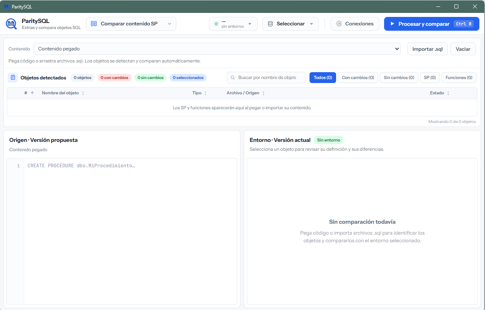

# ParitySQL

Aplicación de escritorio para Windows que permite **comparar y extraer objetos de SQL Server**. Desarrollada con Rust, Tauri y JavaScript.



## Comparar contenido SP

Es la primera herramienta del menú y se abre por defecto.

1. Configura una conexión desde **Conexiones** y selecciona el entorno y la base de datos.
2. Pega el contenido completo de tus procedimientos o funciones, importa archivos con **Importar .sql** o arrástralos al área de contenido.
3. ParitySQL identifica los objetos, consulta sus definiciones en el entorno y los compara automáticamente. Puedes repetir el proceso con **Procesar y comparar** (`Ctrl + R`).
4. Selecciona un objeto del listado para revisar las diferencias de parámetros y contenido.

El panel izquierdo muestra la **versión propuesta** y el derecho la **versión actual del entorno**. Ambos se desplazan juntos y mantienen alineadas las coincidencias. Los marcadores laterales permiten saltar entre diferencias:

- **Verde:** contenido que se propone añadir al entorno.
- **Rojo:** contenido que se propone quitar del entorno.
- **Azul:** bloques con modificaciones.

La comparación solo consulta metadatos; no ejecuta el SQL importado ni modifica la base de datos.

## Extraer objetos

Selecciona **Extraer objetos** en el menú de herramientas. Usa las mismas conexiones de la comparación.

Escribe un nombre de objeto por línea y pulsa **Ejecutar**. Si omites el esquema, se utiliza `dbo`. Puedes copiar o descargar el script generado con `DROP` y `CREATE` de procedimientos, funciones, vistas y triggers.

## Ejecutar desde el código fuente

Requiere Windows, Rust 1.90 o superior, las herramientas de compilación C++ de Visual Studio y WebView2. Instala Tauri CLI una vez:

```powershell
cargo install tauri-cli --version "^2.0"
```

Desde la raíz del proyecto:

```powershell
cargo tauri dev
```

Para generar el instalador:

```powershell
cargo tauri build
```

Los instaladores se generan en `src-tauri/target/release/bundle/`.

## Pruebas

Las pruebas del frontend requieren Node.js.

```powershell
node --test
cargo test --manifest-path src-tauri/Cargo.toml --all-targets --locked
```

## Conexiones y seguridad

La aplicación inicia sin conexiones ni credenciales precargadas. Admite autenticación SQL Server y Windows integrada.

Las conexiones, incluidas sus contraseñas, se guardan **en texto plano en la configuración local del usuario**. Los archivos de conexiones, ajustes privados, claves y exportaciones SQL están excluidos de Git mediante `.gitignore`.

## Más información

- [Configurar actualizaciones desde GitHub](docs/UPDATES.md). Permanecen desactivadas hasta configurar el repositorio y la clave pública.
- [Arquitectura del proyecto](.honk-docs/_project/03_architecture.md).
